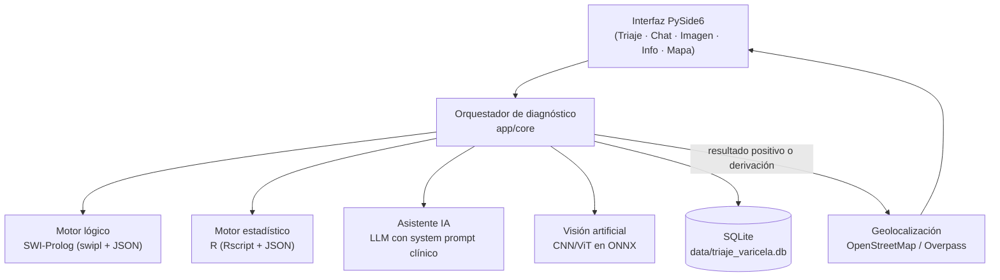
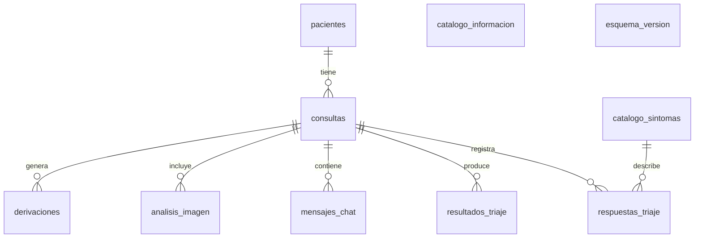

# Arquitectura del sistema — Triaje Varicela

## 1. Visión general

Aplicación de escritorio en Python que orquesta cuatro motores especializados. La interfaz nunca habla directamente con Prolog, R o el modelo de visión: todo pasa por un **orquestador** que combina resultados y aplica la regla de seguridad (derivar al médico ante duda o signos de alarma).

## 2. Componentes y decisiones técnicas

| Componente | Tecnología | Por qué |
|---|---|---|
| Interfaz | **PySide6 (Qt 6)** | Aspecto profesional, tablas y formularios robustos, y `QWebEngineView` para mostrar el mapa Folium dentro de la app. Licencia LGPL. |
| Motor lógico | **SWI-Prolog vía `swipl` + JSON** | Las reglas médicas (fases, diagnóstico diferencial, signos de alarma) se expresan de forma declarativa y explicable: se puede mostrar *qué regla* produjo el dictamen. Se ejecuta como proceso (`prolog/cli.pl`) en lugar de `pyswip`, que en Windows suele fallar al localizar las librerías de SWI-Prolog. |
| Motor estadístico | **R vía `Rscript` + JSON** | Se prefiere a `rpy2` porque en Windows `rpy2` es frágil de instalar. Python envía un JSON por la entrada estándar y R responde otro JSON con probabilidad, intervalo de confianza y riesgo ponderado. Cada lado se puede probar por separado. |
| Base de datos | **SQLite** | Ver sección 3. |
| Asistente IA | LLM detrás de una interfaz `ProveedorLLM` | El proveedor se elige en la Fase 3; la app no depende de uno concreto. El **filtro de seguridad** (signos de alarma, ambigüedad) se ejecuta en Python *antes y después* del LLM, no se deja solo al modelo. |
| Visión | Modelo preentrenado afinado, exportado a **ONNX** | Ver sección 4. |
| Mapa | **Folium + Overpass API (OpenStreetMap)** | Gratuito, sin clave de API. Google Places queda como alternativa opcional. |

### Flujo del triaje

1. La UI recoge respuestas → el orquestador las guarda en `respuestas_triaje`.
2. Se envían **en paralelo** a Prolog (dictamen lógico) y a R (probabilidad).
3. El orquestador combina: si hay cualquier signo `ALARMA` o los motores discrepan mucho → `DERIVAR_MEDICO`. Si no, se usa la tabla de decisión (Prolog + probabilidad de R) para emitir `NEGATIVO_BAJO_RIESGO`, `SOSPECHA_INICIAL` o `ALTA_PROBABILIDAD`.
4. Si el dictamen es `ALTA_PROBABILIDAD` o `DERIVAR_MEDICO`, se habilita el módulo de mapa.

## 3. Base de datos recomendada: SQLite

**Recomendación: SQLite 3** (incluido en Python con el módulo `sqlite3`).

- **Aplicación de escritorio de un solo usuario:** no hace falta un servidor; la base es un único archivo local.
- **Cero instalación:** PostgreSQL obligaría a instalar y administrar un servicio en cada equipo.
- **Privacidad:** los datos de salud se quedan en el equipo del usuario y no viajan por la red.
- **Integridad suficiente:** transacciones ACID, claves foráneas (`PRAGMA foreign_keys = ON`) y restricciones `CHECK`.
- **Portabilidad:** el archivo `.db` se respalda o se mueve copiándolo.

**Cuándo migrar a PostgreSQL:** si en el futuro varios médicos comparten historiales desde un servidor central. El esquema usa SQL estándar para que esa migración sea sencilla. Si se necesita cifrar el archivo en reposo, se puede usar **SQLCipher** sin cambiar el esquema.

El script está en [`database/schema.sql`](../database/schema.sql).

## 4. Visión artificial: enfoque recomendado

**Enfoque principal:** *transfer learning* de una red preentrenada (EfficientNet-B0/B3 o ViT-Small vía `timm`) afinada con un dataset de lesiones cutáneas que incluya varicela y sus diagnósticos diferenciales (sarampión, mpox, impétigo, picaduras, dermatitis, piel sana). Datasets candidatos: *Mpox Skin Lesion Dataset (MSLD v2.0)*, que trae clase de varicela, y DermNet (revisar licencia). ISIC sirve poco aquí porque se centra en melanoma y lunares, no en exantemas.

- **Preprocesamiento:** corrección de orientación EXIF, recorte central, redimensión a 224×224 (o 384 en ViT), normalización ImageNet; aumentos en entrenamiento (giros, brillo, tono de piel).
- **Manejo de confianza:** calibración por *temperature scaling* y un umbral configurable (`VISION_UMBRAL_CONFIANZA`). Por debajo del umbral, o con imagen borrosa u oscura, la decisión es **`INDETERMINADO`** y se recomienda acudir al médico.
- **Inferencia en la app con ONNX Runtime:** evita instalar PyTorch (varios GB) en el equipo del usuario.
- **Apoyo opcional:** un modelo multimodal puede dar una segunda opinión descriptiva, pero no sustituye al clasificador medido con métricas.

> Límite honesto: con datasets públicos pequeños, un "alto grado de confianza" solo es creíble si se mide (sensibilidad, especificidad, matriz de confusión) en un conjunto de prueba que el modelo no haya visto. Eso se documentará en la Fase 3.

## 5. Geolocalización

Un equipo de escritorio no suele tener GPS. Orden de intento: (1) servicio de ubicación de Windows si el usuario lo permite, (2) ubicación aproximada por IP, (3) dirección escrita por el usuario y geocodificada con `geopy`/Nominatim. Luego se consulta Overpass por `amenity=hospital|clinic|doctors` en un radio dado y se calcula la distancia.

## 6. Plan por fases

| Fase | Contenido |
|---|---|
| 1 | Arquitectura, base de datos, estructura de carpetas, dependencias. |
| 2 | Base de conocimientos en Prolog y scripts estadísticos en R, cada uno con pruebas propias. |
| 3 | Núcleo Python: acceso a BD, puentes con Prolog y R, orquestador. |
| 4 | Asistente IA conversacional y módulo de visión. |
| 5 | Interfaz gráfica completa, Centro Informativo y mapa. |
